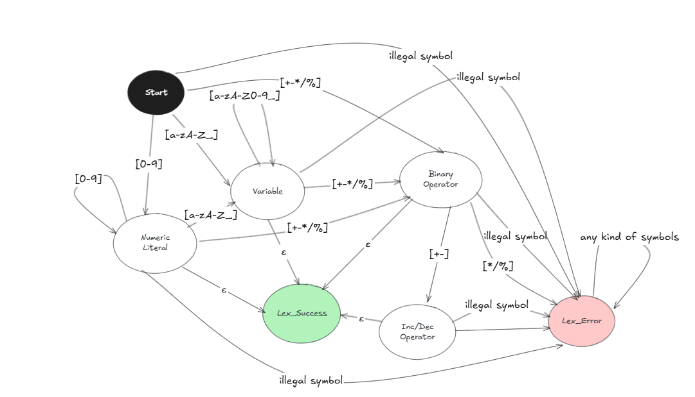
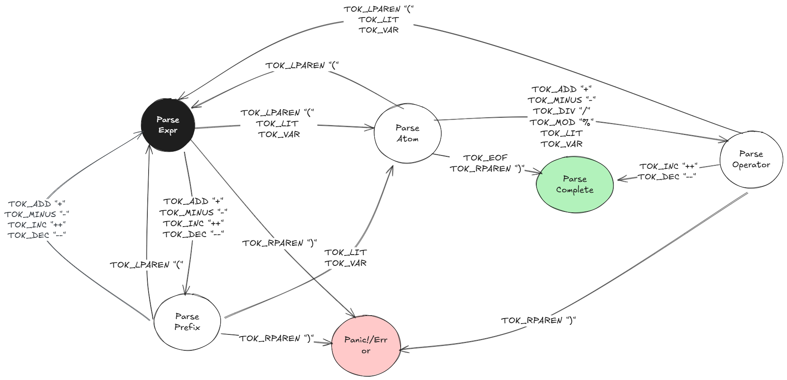
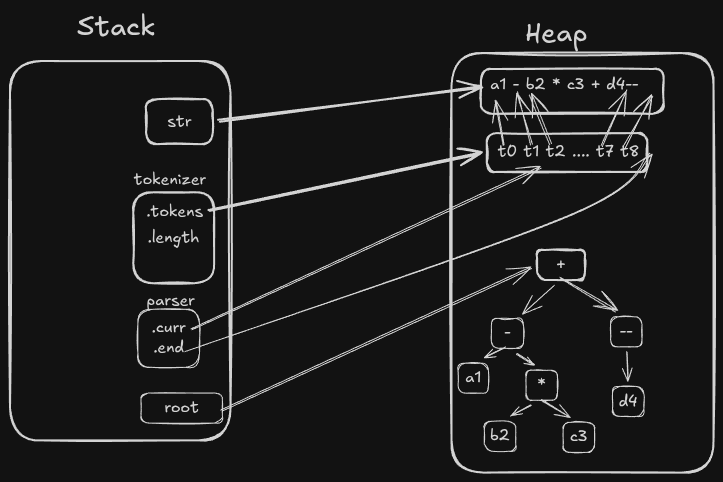

# Design Notes
## State Machines: Modelling Different Stages of Lexing and Parsing
### Lexer

Above depicted the (ideal) lexing process with a state machine
- Start state is `Start`
- An empty string (symbol) is denoted with the greek letter `ε`
- Valid end states are `Lex_Success` and `Lex_Error`

### Parser

Above is a depiction of how an expression would be parsed using a state machine
- start state is `parse_expr`.
- valid end states are `Panic!/Error` and `Parse Complete`

## Data Flow Diagram

## Memory Layout/Model for This Project

